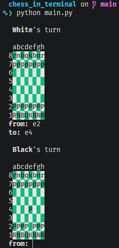

# Chess in terminal

授業中にチェスをするためのプロジェクトです

- Python
- 単一ファイル & 小さめ (~500行)
- 外部ライブラリへの依存なし

> [!WARNING]  
> このプロジェクトは開発中です

- [x] 基本の駒の動き
- [x] Pawnの初手2マス進める動き
- [x] Castling
- [x] En Passant
- [x] Promotion
- [x] Checkされているときの動作
- [x] 勝敗判定
- [x] 移動の始点と終点を入力するスタイル
- [x] 対戦(2人プレイ)
- [ ] 対戦(vs AI)

